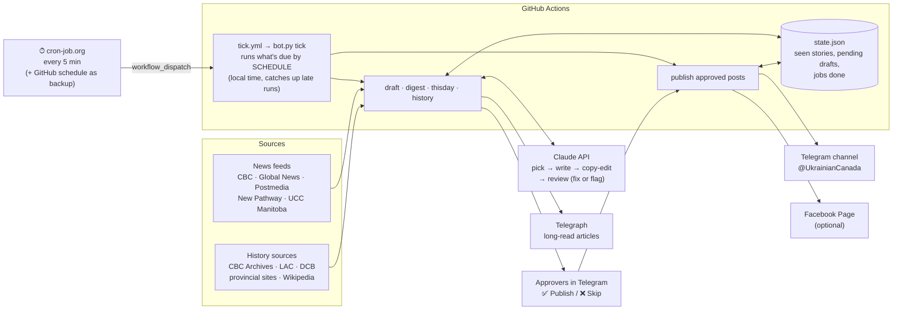
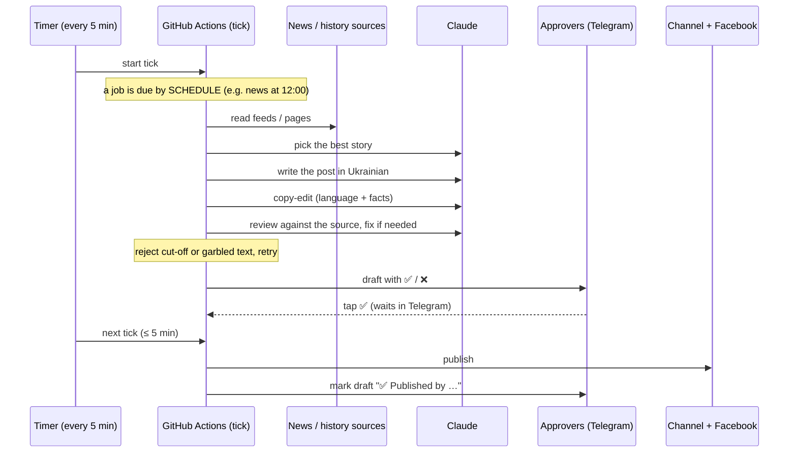

# Community AI Autoposter

**An AI editorial assistant for community news channels**, reusable for any community or language. It runs the Telegram channel
[Українська Канада (@UkrainianCanada)](https://t.me/UkrainianCanada), about 17,000 Ukrainians living in
Canada: every day it finds the news and history that matter to this community, writes posts in literary
Ukrainian with Claude, and sends each one to human editors for one-tap approval before anything is published.
Any other community can run its own channel by changing two settings files (see
[Reusable for any community](#reusable-for-any-community)).

**Live demo:** [t.me/UkrainianCanada](https://t.me/UkrainianCanada)

### What it does

- **News, 5 times a day.** Reads 30+ Canadian feeds (CBC and Global News for every province and territory,
  Postmedia papers, Ukrainian-Canadian outlets), puts Ukrainian-community stories first, and writes a short,
  self-contained post in Ukrainian from the full article.
- **Morning digest.** Yesterday's key national stories, rotating provincial highlights, community news and
  "what happens today", each item linked to its source, with a mix of outlets.
- **Canadian history.** A daily "This day in Canadian history" post and a history long-read, published as
  Telegraph articles (Instant View in Telegram), grounded in Canadian archives and encyclopedias.
- **Human in the loop.** Every draft goes to the editors in Telegram with ✅ / ❌; nothing is published
  without approval (optional timed auto-publish per post type). Approved posts also go to the Facebook Page.

### Engineering highlights

- **Writer, copy editor, reviewer.** Claude (Anthropic's AI model, used through the Claude API) writes; a separate
  "copy editor" pass checks language and verifies every name, number and date against the source; then a
  "reviewer" agent checks the result against the source (on topic, facts, repetition, completeness, language),
  fixes it with its own notes and checks again, flagging anything left for the human editors. Output that comes
  back cut off or garbled is rejected and regenerated. A Ukrainian style guide (no russianisms or calques,
  Canadian terminology, typography) is part of every prompt.
- **Structured outputs through tool use.** Every answer the code relies on (picks, posts, review verdicts, the
  digest) comes back through Claude's tool use with a JSON schema, so it is always well-formed: no text parsing
  guesswork and no retries for broken JSON.
- **Token-efficient.** The source article is sent once as a cached block and reused by the writer, copy editor,
  reviewer and fixer (prompt caching), and headline lists for story picking are trimmed. Each run's log ends with
  a "Claude usage" line (input, cache write, cache read, output tokens).
- **Source-grounded content.** Posts use only facts from the fetched article; history prefers Canadian
  institutions (Dictionary of Canadian Biography, Library and Archives Canada, CBC Archives, provincial
  societies), with Wikipedia only as a fallback. Images are checked to be real photos (not logos or banners),
  with freely licensed Wikimedia Commons photos as a fallback.
- **Serverless and free to run.** GitHub Actions jobs started every 5 minutes by a free external timer, Telegram Bot API, Telegraph API and the
  Facebook Graph API; state is a JSON file in the repo, with a three-way merge so overlapping runs never lose
  a draft or double-post. No servers, no database, no third-party Python packages.
- **Configurable, not hard-coded.** Sources, schedules, approvers, referral offers and publishing rules live in
  `config.py`; all editorial instructions live in `prompts.py`, so the same code can serve another community.

### Reusable for any community

Nothing specific to this channel is hard-coded: `bot.py` contains no names, sources, languages, countries or
time zones. Anyone with the same use case (a community channel on Telegram and/or a Facebook Page) can fork
the repo and change only the settings and the prompts:

| Change | In |
|---|---|
| Telegram channel, bot name, time zone, approvers' auto-publish rules, model, limits | `config.py` |
| News feeds and regions; which stories count as community news (`COMMUNITY_WORDS`, `COMMUNITY_REGIONS`) | `config.py` |
| History sources, "people of the day" page, community-history day and sources, Wikipedia language | `config.py` |
| Fixed words in posts (headers, "Source", "Read more", month names) and the language of the channel | `config.py` → `LABELS`, `MONTHS` |
| Referral offers | `config.py` → `REFERRALS` |
| Audience, what counts as important, length and structure of posts, style guide for the language | `prompts.py` |
| Run times (local time zone, `TIMEZONE`) | `config.py` → `SCHEDULE` |
| Bot token, approvers, API and Facebook keys | GitHub secrets |

Examples: a Polish- or Filipino-Canadian channel, a city news channel for newcomers, a diaspora in another
country, a university or church community, a professional association. Facebook is optional; the history
columns can use any country's archives, or be switched off by removing their schedules.

**Stack:** Python 3 (standard library only) · Claude API (Claude Sonnet 5.5 by Anthropic) · GitHub Actions · Telegram Bot API ·
Telegraph API · Facebook Graph API · RSS/Atom

## How it works

### Life of a post

### Workflows (Actions tab)

| Workflow | File | What it does |
|---|---|---|
| Tick (every 5 minutes) | `tick.yml` | The engine: runs whatever is due by `SCHEDULE`, then publishes approved posts. Started by cron-job.org (and GitHub's schedule as a backup). |
| Publish approved posts | `approve.yml` | Publish approved posts right now |
| Draft posts | `draft.yml` | Make a news draft now |
| Draft morning digest | `digest.yml` | Make the digest now |
| Draft this-day post | `thisday.yml` | Make a "This day" draft now |
| Draft history story | `history.yml` | Make a history long-read now (tick "Community-history story" for a Ukrainian-Canadian one) |
| Rewrite a published long-read | `rewrite.yml` | Rewrite a published Telegraph article in place from a source you give |
| Preview Facebook cards | `cards.yml` | Draw the sample cards in `samples/cards.json` and send them to the approvers |
| Check connections | `check.yml` | Test the Telegram and Facebook tokens without posting (shows the page name and when the Facebook token expires) |

All of them except Tick are for running something by hand: Actions → pick it → Run workflow.

## Daily schedule (Toronto time)

| Time | Draft |
|---|---|
| 6:30 | 🗞 Morning digest: yesterday's news, regions, Ukrainian community, what happens today, a referral link |
| 8:30 | 📅 Цей день в історії Канади: an event or a person on today's date (alternating) |
| 9:00, 12:00, 15:00, 18:00, 21:00 | 📰 News post (Ukrainian-community stories first) |
| 11:30 | 🍁 Історія Канади long-read (Sundays: a Ukrainian-Canadian story) |
| every 5 min, around the clock | Publisher: posts what was approved; drafts not tapped expire after 24 hours |

Times are local (`TIMEZONE` in `config.py`), daylight saving time included. GitHub sometimes starts scheduled
runs late; a job that is late by less than `CATCH_UP_HOURS` still runs.

## What each post looks like

**News.** Claude picks the most relevant story from the feeds, reads the full article and writes 2-3 short
paragraphs (what happened, key details, why it matters for Ukrainians in Canada). A "copy editor" pass checks the
Ukrainian and the facts, and the reviewer agent checks the post against the article (see below). The post ends
with the source link; Telegram shows the article's picture. When an offer clearly fits the story, one referral
line can be added (see Referral links).

**Ukrainian community.** Stories in the Canadian feeds that mention Ukraine or Ukrainians, plus everything from
New Pathway and UCC Manitoba, are always passed to the picker (even when older than a feed's newest 8) and get
top priority: churches, organizations, events, newcomers, incidents such as vandalism at a church.

**Morning digest** ("🗞 Головне за вчора"): the 3-5 most important national stories from yesterday; 1-2
stories from 3-4 provinces or territories (rotating so every region is featured over the week);
"🇺🇦 Українська громада" when there is community news; "📌 Сьогодні": up to 3 things the news says happen
today (left out when there are none). A key phrase in each item links to the source, outlets are mixed
(CBC, Global News, Postmedia papers), and it ends with "За матеріалами: ..." and a referral link.

**History long-reads.** Written as Telegraph articles (telegra.ph, open inside Telegram with Instant View),
with photo, subheadings and the source credited at the end. The channel gets a teaser with one bold
"📖 Читати повністю →" link. A skipped or expired draft's Telegraph page is blanked.
- 📅 *Цей день*: people from the Dictionary of Canadian Biography (`PEOPLE_OF_THE_DAY`); events from
  Wikipedia "On this day" (entries matching `THISDAY_WORDS`), because the Canadian sites with dated events
  block automated access.
- 🍁 *Історія Канади*: Canadian sources first (`HISTORY_SOURCES`: CBC Archives, Library and Archives Canada,
  Ontario Heritage Trust, Quebec Anglophone Heritage Network, Manitoba Historical Society, Encyclopedia of
  Saskatchewan, RETROactive Alberta). Wikipedia (`WIKI_REGIONAL_TOPICS`) is the fallback and covers BC, the
  Atlantic provinces and the North, whose history sites can't be read automatically.
- Sundays (`COMMUNITY_HISTORY_DAY`): Ukrainian-Canadian stories (`COMMUNITY_HISTORY_SOURCES`; fallback
  `COMMUNITY_HISTORY_TOPICS`). For one on another day: Actions → "Draft history story" → tick
  "Community-history story".
- To fix a published long-read: Actions → "Rewrite a published long-read" → give the page (the part after
  `telegra.ph/`) and a source (URL or `wiki:Title`). The article is rewritten in place with the current
  prompts, copy edit, reviewer and photo search; the link stays the same. Only the Telegraph article changes:
  the teaser already posted in the channel can't be edited by the bot. The run's log shows the new title,
  teaser and anything the reviewer still flagged.
- Photos: the source's own picture if it is a real photo (logos and banners are rejected), otherwise a freely
  licensed photo of the subject from Wikimedia Commons.

**Reviewer agent.** Before a news post or long-read reaches the approvers, a separate Claude call checks it
against its source: on topic (not mainly about something the source only mentions), every fact supported,
no repetition or padding, no remarks about sources, complete, good Ukrainian. If it finds problems, the bot fixes
the draft with those notes and checks again; anything still wrong is listed under the draft as
"⚠️ Перевірка знайшла проблеми, перегляньте уважно:" with the problems in Ukrainian (shown to approvers only,
never published). It adds about 1-3 Claude calls per post. The digest is not reviewed this way (it is built from
headlines and summaries only).

**Language.** Every post follows the style guide in `prompts.py` (literary Ukrainian, no russianisms or
calques, Canadian terms, original English names in brackets on first mention, Ukrainian typography) and goes
through the copy-edit pass and the reviewer. Look-alike Latin letters inside Ukrainian words (a common AI slip)
are corrected automatically. Still read drafts before approving; add recurring mistakes to the style guide.

## Referral links

The morning digest ends with one link from `REFERRALS` in `config.py`, a different one each day. A news post
gets one only when an offer clearly fits the story (e.g. interest rates → investing, money to Ukraine → Wise),
never on tragedies, war or crime, and at most `REFERRALS_IN_NEWS_PER_DAY` (1) per day. History posts never
carry referral links. `REFERRAL_DISCLOSURE` can add a line under the link (empty = none). Update the bonus
amounts in `REFERRALS` when an offer changes.

## Approvers and publishing

- Everyone listed in the `TELEGRAM_ADMIN_ID` secret gets each draft; whoever taps first decides, and every
  copy then shows "✅ Published by …" or "❌ Skipped by …".
- A draft may carry notes for approvers only (never published): "⚠️ Перевірка знайшла проблеми…" from the
  reviewer, or "⏱ Опублікується автоматично о …" when auto-publish is on.
- If taps seem to do nothing (buttons stay, nothing is published), another program may be using the bot's
  token: replace it in @BotFather (/mybots → API Token → Revoke) and update the `TELEGRAM_BOT_TOKEN` secret.
- To publish an approved post right away: Actions → "Publish approved posts" → Run workflow.
- **Publishing without approval** is off. In `config.py`, `AUTO_PUBLISH` can switch it on per kind of post
  (news, digest, thisday, history): such drafts show "⏱ Опублікується автоматично о …" and go out after
  `AUTO_PUBLISH_AFTER_MINUTES` (60) unless someone taps ❌.

## Facebook Page

When the secrets `FACEBOOK_PAGE_ID` and `FACEBOOK_PAGE_TOKEN` are set, every published post also goes to the
Facebook Page, built for Facebook readers:
- **Picture card** (`card.html`, drawn with headless Chrome): the headline over a freely licensed Wikimedia
  Commons photo (the writer suggests several searches: monument, place, object), or a centred text layout with
  an ornament band when none fits. Approvers see the card with each draft. Try design changes with the
  **Preview Facebook cards** workflow (`samples/cards.json`).
- **Full text, no links.** In Canada Meta blocks links to news outlets (Online News Act), even in comments,
  and link posts reach fewer people. Sources stay named in plain text; long-reads go in whole.
- **First comment** with the links Facebook allows: the Telegram channel and, for long-reads, the Telegraph
  version (`FB_COMMENT`, `FB_COMMENT_READ_MORE`). Needs the `pages_manage_engagement` permission.
- Referral links stay off Facebook (`FB_REFERRALS`).
If Facebook fails, the Telegram post still goes out and the draft says "Facebook failed".

Getting the keys (you must be an admin of the Page):
1. developers.facebook.com/apps → Create App. Use case: Content management → **Manage everything on your
   Page**. Business portfolio: "I don't want to connect a business portfolio yet".
2. App → Use cases → Manage everything on your Page → Customize: add `pages_manage_posts` and
   `pages_read_engagement` (no App Review needed for your own Page).
3. developers.facebook.com/tools/explorer: select the app; permissions `pages_show_list`,
   `pages_read_engagement`, `pages_manage_posts`, `pages_manage_engagement` (plus `pages_read_user_content`, which
   it needs, added in the use case first) and, if the Page belongs to a business portfolio,
   `business_management`. Generate Access Token; in the pop-up tick the business and the Page.
4. developers.facebook.com/tools/debug/accesstoken: paste the token → Debug → Extend Access Token; copy it.
5. Back in the Explorer, paste the extended token and GET `me/accounts?fields=id,name,access_token`.
   If `data` is empty, the Page wasn't granted (see step 3). Copy the Page's `id` and its `access_token`
   (the Page token, not your user token; the debug tool should show Type: Page, Expires: Never).
6. Save them as the secrets `FACEBOOK_PAGE_ID` and `FACEBOOK_PAGE_TOKEN`, then run **Check connections**
   (`check.yml`) in the Actions tab: it shows the Page name and token expiry and posts nothing.
If posts don't appear publicly, switch the Meta app to Live (it asks for a privacy policy URL).

## Setup from scratch

1. GitHub repo with these files (keep the `.github/workflows` folder). Public is fine: no keys are stored in
   files, and GitHub Actions is free for public repos.
2. Telegram: create a bot with @BotFather; each approver opens the bot and presses Start; make the bot an
   admin of the channel with "Post messages". Approver IDs: message @userinfobot.
3. Secrets (Settings → Secrets and variables → Actions):
   - `ANTHROPIC_API_KEY`: from console.anthropic.com (API usage is billed separately from a Claude plan)
   - `TELEGRAM_BOT_TOKEN`: from @BotFather
   - `TELEGRAM_ADMIN_ID`: approver IDs separated by commas, e.g. `456360947,522929986`
   - `TELEGRAPH_TOKEN`: Telegraph account key (without it, each run uses a temporary account)
   - optional: `FACEBOOK_PAGE_ID`, `FACEBOOK_PAGE_TOKEN`
4. Timer: GitHub's own schedule can be unreliable (it never fired for this repo), so an external timer starts
   the tick:
   - GitHub → Settings → Developer settings → Fine-grained tokens → new token for this repository only,
     permission **Actions: Read and write**.
   - cron-job.org → Create cronjob: URL
     `https://api.github.com/repos/OWNER/REPO/actions/workflows/tick.yml/dispatches`, every 5 minutes,
     method POST, headers `Authorization: Bearer <token>` and `Accept: application/vnd.github+json`,
     body `{"ref":"main"}`. A test run returns 204 and a "Tick" run appears in Actions.
5. Test: Actions → "Draft posts" → Run workflow; a draft should arrive in Telegram within a minute.

## Where things are

| What you want to change | Where |
|---|---|
| Channel, time zone, fixed words in posts, news and history sources, referral links, auto-publish, model, limits | `config.py` |
| Tone, Ukrainian style guide, what to pick, length and structure of each post | `prompts.py` |
| Run times (local time) | `config.py` → `SCHEDULE` |
| API keys, bot token, approver IDs, Telegraph and Facebook keys | GitHub → Settings → Secrets and variables → Actions |
| The program itself | `bot.py` (no settings inside) |
| What the bot remembers (seen stories, pending drafts, rotation) | `state.json` (automatic; don't edit by hand) |

The timer is cron-job.org (see Setup, step 4); the `cron:` line in `tick.yml` is a backup. GitHub runs its
own schedules on behalf of the person who last changed a `cron:` line, so after forking, edit that line
yourself on github.com. Either way the tick never does the same job twice.
`save_state.sh` saves `state.json` after every run and
merges safely when two runs finish at the same time.

## Notes

- Sources that couldn't be used: National Post (no readable feed for automated requests), The Canadian
  Encyclopedia (blocks automated access), Canada's History (needs JavaScript), several provincial history
  sites (BC, Atlantic, North).
- If a feed breaks, the run log shows `FEED ERROR` and the other feeds still work.
- Costs: Claude API roughly $18-25/month with Sonnet for everything, including the copy-edit and reviewer passes,
  thanks to prompt caching (see the Anthropic console);
  GitHub Actions free (public repo); cron-job.org, Telegram and Telegraph free.
- GitHub pauses scheduled workflows in a repo with no activity for 60 days; the bot's own state commits
  normally keep it active, but if it happens, re-enable them in the Actions tab.
