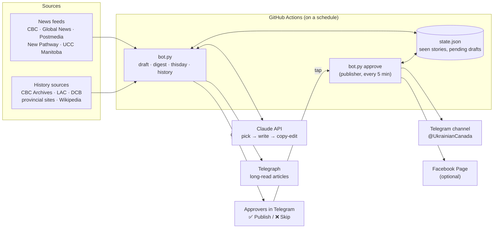
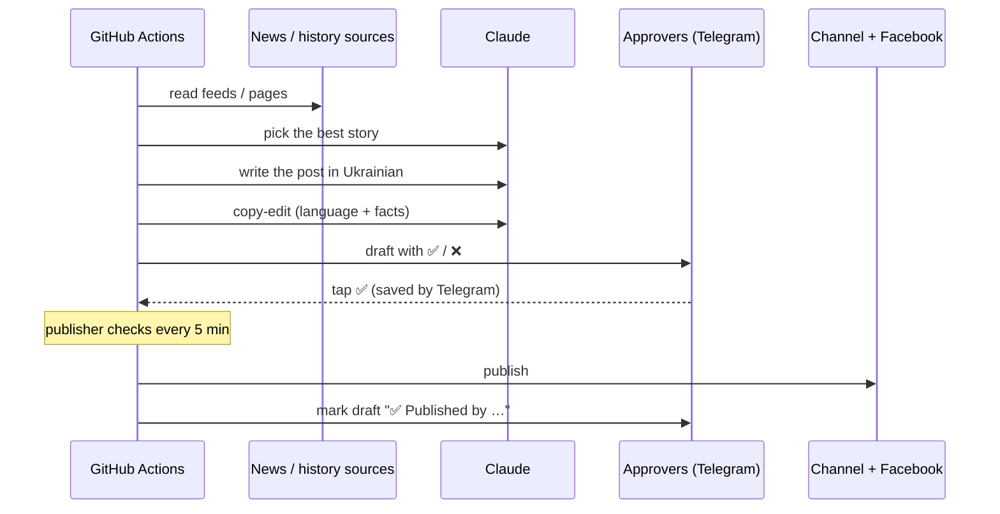

# Community AI Autoposter

**An AI editorial assistant for a community news channel.** It runs the Telegram channel
[Українська Канада (@UkrainianCanada)](https://t.me/UkrainianCanada), about 17,000 Ukrainians living in
Canada: every day it finds the news and history that matter to this community, writes posts in literary
Ukrainian with Claude, and sends each one to human editors for one-tap approval before anything is published.

**Live demo:** [t.me/UkrainianCanada](https://t.me/UkrainianCanada)

### What it does

- **News, 5 times a day.** Reads 30+ Canadian feeds (CBC and Global News for every province and territory,
  Postmedia papers, Ukrainian-Canadian outlets), puts Ukrainian-community stories first, and writes a short,
  self-contained post in Ukrainian from the full article.
- **Morning digest.** Yesterday's key national stories, rotating provincial highlights, community news and
  "what happens today", each item linked to its source, with a mix of outlets.
- **Canadian history.** A daily "This day in Canadian history" post and a history long-read, published as
  Telegraph articles (Instant View in Telegram), grounded in Canadian archives and encyclopedias.
- **Human in the loop.** Every draft goes to the editors in Telegram with ✅ / ❌; nothing is published
  without approval (optional timed auto-publish per post type). Approved posts also go to the Facebook Page.

### Engineering highlights

- **Two-pass generation.** Claude writes, then a separate "copy editor" pass checks language and verifies every
  name, number and date against the source. A Ukrainian style guide (no russianisms or calques, Canadian
  terminology, typography) is part of every prompt.
- **Source-grounded content.** Posts use only facts from the fetched article; history prefers Canadian
  institutions (Dictionary of Canadian Biography, Library and Archives Canada, CBC Archives, provincial
  societies), with Wikipedia only as a fallback. Images are checked to be real photos (not logos or banners),
  with freely licensed Wikimedia Commons photos as a fallback.
- **Serverless and free to run.** Scheduled GitHub Actions jobs, Telegram Bot API, Telegraph API and the
  Facebook Graph API; state is a JSON file in the repo, with a three-way merge so overlapping runs never lose
  a draft or double-post. No servers, no database, no third-party Python packages.
- **Configurable, not hard-coded.** Sources, schedules, approvers, referral offers and publishing rules live in
  `config.py`; all editorial instructions live in `prompts.py`, so the same code can serve another community.

**Stack:** Python 3 (standard library only) · Claude API (Sonnet) · GitHub Actions · Telegram Bot API ·
Telegraph API · Facebook Graph API · RSS/Atom

## How it works

### Life of a post

## Daily schedule (Toronto time, winter)

| Time | Draft |
|---|---|
| 6:30 | 🗞 Morning digest: yesterday's news, regions, Ukrainian community, what happens today, a referral link |
| 8:30 | 📅 Цей день в історії Канади: an event or a person on today's date (alternating) |
| 9:00, 12:00, 15:00, 18:00, 21:00 | 📰 News post (Ukrainian-community stories first) |
| 11:30 | 🍁 Історія Канади long-read (Sundays: a Ukrainian-Canadian story) |
| every 5 min, 6:00-midnight | Publisher: posts what was approved; drafts not tapped expire after 24 hours |

GitHub schedules run in UTC, so from March to November (daylight time) everything runs an hour later in
Toronto unless the `cron:` lines are adjusted. Scheduled runs can be a few minutes late when GitHub is busy.

## What each post looks like

**News.** Claude picks the most relevant story from the feeds, reads the full article and writes 2-3 short
paragraphs (what happened, key details, why it matters for Ukrainians in Canada), then a second "copy editor"
pass checks the Ukrainian and the facts. The post ends with the source link; Telegram shows the article's
picture.

**Ukrainian community.** Stories in the Canadian feeds that mention Ukraine or Ukrainians, plus everything from
New Pathway and UCC Manitoba, are always passed to the picker (even when older than a feed's newest 8) and get
top priority: churches, organizations, events, newcomers, incidents such as vandalism at a church.

**Morning digest** ("🗞 Головне за вчора"): the 3-5 most important national stories from yesterday; 1-2
stories from 3-4 provinces or territories (rotating so every region is featured over the week);
"🇺🇦 Українська громада" when there is community news; "📌 Сьогодні": up to 3 things the news says happen
today (left out when there are none). A key phrase in each item links to the source, outlets are mixed
(CBC, Global News, Postmedia papers), and it ends with "За матеріалами: ..." and a referral link.

**History long-reads.** Written as Telegraph articles (telegra.ph, open inside Telegram with Instant View),
with photo, subheadings and the source credited at the end. The channel gets a teaser with one bold
"📖 Читати повністю →" link. A skipped or expired draft's Telegraph page is blanked.
- 📅 *Цей день*: people from the Dictionary of Canadian Biography; events from Wikipedia "On this day"
  (Canadian entries), because the Canadian sites with dated events block automated access.
- 🍁 *Історія Канади*: Canadian sources first (`HISTORY_SOURCES`: CBC Archives, Library and Archives Canada,
  Ontario Heritage Trust, Quebec Anglophone Heritage Network, Manitoba Historical Society, Encyclopedia of
  Saskatchewan, RETROactive Alberta). Wikipedia (`WIKI_REGIONAL_TOPICS`) is the fallback and covers BC, the
  Atlantic provinces and the North, whose history sites can't be read automatically.
- Sundays: Ukrainian-Canadian stories (`UKRAINIAN_CANADIAN_SOURCES`; fallback `UKRAINIAN_CANADIAN_TOPICS`).
  For one on another day: Actions → "Draft history story" → tick "Ukrainian-Canadian story".
- Photos: the source's own picture if it is a real photo (logos and banners are rejected), otherwise a freely
  licensed photo of the subject from Wikimedia Commons.

**Language.** Every post follows the style guide in `prompts.py` (literary Ukrainian, no russianisms or
calques, Canadian terms, original English names in brackets on first mention, Ukrainian typography) and goes
through the copy-edit pass. Still read drafts before approving; add recurring mistakes to the style guide.

## Referral links

The morning digest ends with one link from `REFERRALS` in `config.py`, a different one each day. A news post
gets one only when an offer clearly fits the story (e.g. interest rates → investing, money to Ukraine → Wise),
never on tragedies, war or crime, and at most `REFERRALS_IN_NEWS_PER_DAY` (1) per day. History posts never
carry referral links. `REFERRAL_DISCLOSURE` can add a line under the link (empty = none). Update the bonus
amounts in `REFERRALS` when an offer changes.

## Approvers and publishing

- Everyone listed in the `TELEGRAM_ADMIN_ID` secret gets each draft; whoever taps first decides, and every
  copy then shows "✅ Published by …" or "❌ Skipped by …".
- To publish an approved post right away: Actions → "Publish approved posts" → Run workflow.
- **Publishing without approval** is off. In `config.py`, `AUTO_PUBLISH` can switch it on per kind of post
  (news, digest, thisday, history): such drafts show "⏱ Опублікується автоматично о …" and go out after
  `AUTO_PUBLISH_AFTER_MINUTES` (60) unless someone taps ❌.

## Facebook Page

When the secrets `FACEBOOK_PAGE_ID` and `FACEBOOK_PAGE_TOKEN` are set, every published post also goes to the
Facebook Page as plain text with a link card (long-reads link to the Telegraph article). If Facebook fails,
the Telegram post still goes out and the draft says "Facebook failed".

Getting the keys (you must be an admin of the Page):
1. developers.facebook.com → My Apps → Create App → Other → Business.
2. Tools → Graph API Explorer: select the app; add permissions `pages_show_list`, `pages_read_engagement`,
   `pages_manage_posts`; Generate Access Token; choose the Page.
3. ⓘ next to the token → Open in Access Token Tool → Extend Access Token; copy it.
4. In Graph API Explorer, paste the extended token and request `me/accounts`; copy the Page's `id` and
   `access_token` (it doesn't expire).
5. Save them as the secrets `FACEBOOK_PAGE_ID` and `FACEBOOK_PAGE_TOKEN`.
If posts don't appear publicly, switch the Meta app to Live (it asks for a privacy policy URL).

## Setup from scratch

1. GitHub repo with these files (keep the `.github/workflows` folder). Public is fine: no keys are stored in
   files, and GitHub Actions is free for public repos.
2. Telegram: create a bot with @BotFather; each approver opens the bot and presses Start; make the bot an
   admin of the channel with "Post messages". Approver IDs: message @userinfobot.
3. Secrets (Settings → Secrets and variables → Actions):
   - `ANTHROPIC_API_KEY`: from console.anthropic.com (API usage is billed separately from a Claude plan)
   - `TELEGRAM_BOT_TOKEN`: from @BotFather
   - `TELEGRAM_ADMIN_ID`: approver IDs separated by commas, e.g. `456360947,522929986`
   - `TELEGRAPH_TOKEN`: Telegraph account key (without it, each run uses a temporary account)
   - optional: `FACEBOOK_PAGE_ID`, `FACEBOOK_PAGE_TOKEN`
4. Test: Actions → "Draft posts" → Run workflow; a draft should arrive in Telegram within a minute.

## Where things are

| What you want to change | Where |
|---|---|
| Channel, news sources, history sources, referral links, auto-publish, model, limits | `config.py` |
| Tone, Ukrainian style guide, what to pick, length and structure of each post | `prompts.py` |
| Run times (UTC: Toronto + 5 hours in winter, + 4 in summer) | `cron:` lines in `.github/workflows/*.yml` |
| API keys, bot token, approver IDs, Telegraph and Facebook keys | GitHub → Settings → Secrets and variables → Actions |
| The program itself | `bot.py` (no settings inside) |
| What the bot remembers (seen stories, pending drafts, rotation) | `state.json` (automatic; don't edit by hand) |

Workflows: `draft.yml` (news), `digest.yml`, `thisday.yml`, `history.yml`, `approve.yml` (publisher). Each can
be started by hand: Actions → pick it → Run workflow. `save_state.sh` saves `state.json` after every run and
merges safely when two runs finish at the same time.

## Notes

- Sources that couldn't be used: National Post (no readable feed for automated requests), The Canadian
  Encyclopedia (blocks automated access), Canada's History (needs JavaScript), several provincial history
  sites (BC, Atlantic, North).
- If a feed breaks, the run log shows `FEED ERROR` and the other feeds still work.
- Costs: Claude API about $20-25/month with Sonnet for everything (see the Anthropic console);
  GitHub Actions free (public repo); Telegram and Telegraph free.
- GitHub pauses scheduled workflows in a repo with no activity for 60 days; the bot's own state commits
  normally keep it active, but if it happens, re-enable them in the Actions tab.
